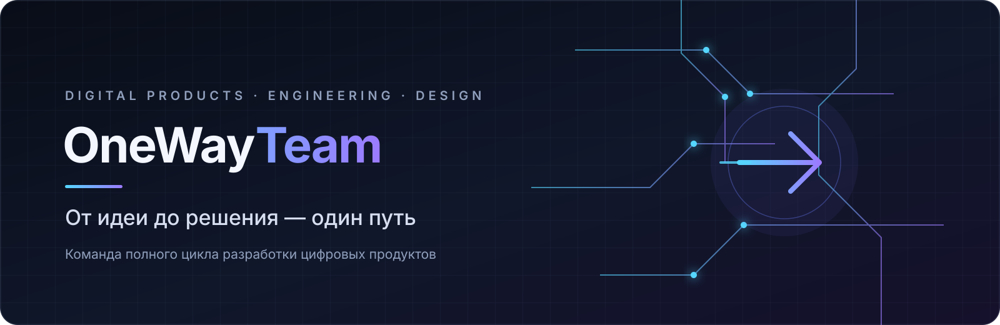

  

<h1 align="center">OneWayTeam</h1>

  <strong>От идеи до решения — один путь</strong> 
  Команда полного цикла разработки цифровых продуктов

  
  
  

## Кто мы

**OneWayTeam** — команда из четырёх разработчиков. Создаём цифровые продукты: от веб-приложений и мобильных решений до серверной логики, API и проектирования архитектуры.

Работаем над полным циклом разработки: изучаем задачу, продумываем пользовательский опыт, проектируем решение, реализуем его и готовим к развёртыванию. Ценим быструю коммуникацию, индивидуальный подход и разумные эксперименты с новыми технологиями.

## Наши проекты

### Career Navigator

Веб-приложение для профориентации школьников с ИИ-аналитикой, помогающее исследовать карьерные направления и принимать более осознанные решения о будущем.

[Репозиторий проекта](https://github.com/OneWayTeam/CareerNavigator)

### Twosick

Веб-приложение для совместного синхронного прослушивания музыки с разных устройств.

[Репозиторий проекта](https://github.com/OneWayTeam/Twosic)

### My Pet Finny

Мобильное приложение, которое помогает детям знакомиться с основами финансовой грамотности.

> Публичная ссылка на репозиторий или страницу приложения пока не указана.

### Другой репозиторий

[OneWayTeam/Sandbox](https://github.com/OneWayTeam/Sandbox) — репозиторий организации; назначение не описано в предоставленных материалах.

## Технологии

  
  
  
  
  
  

Также занимаемся UI/UX-дизайном, проектированием архитектуры, разработкой backend и API, интеграциями, автоматизацией, базами данных и поддержкой существующих продуктов.

## Команда

| Участник | Роль | GitHub |
|---|---|---|
| **Евгений Миусский** | Team Lead, UI/UX-дизайн, frontend | [@GameCharge](https://github.com/GameCharge) |
| **Арина Яриш** | Backend-разработка | [@arisarina238](https://github.com/arisarina238) |
| **Анна Сморгун** | Backend-разработка | [@smorchook](https://github.com/smorchook) |
| **Матвей Головачев** | Backend-разработка, deploy | [@PrismaRin4iK](https://github.com/PrismaRin4iK) |

## Сотрудничество

Открыты к профессиональным партнёрствам, участию в хакатонах и конкурсах, обмену опытом и техническим коллаборациям.

Если у вас есть идея проекта или предложение о сотрудничестве, свяжитесь с командой через **Team Lead — Евгения Миусского**: [GitHub-профиль @GameCharge](https://github.com/GameCharge).

---

  OneWayTeam · От идеи до решения — один путь

